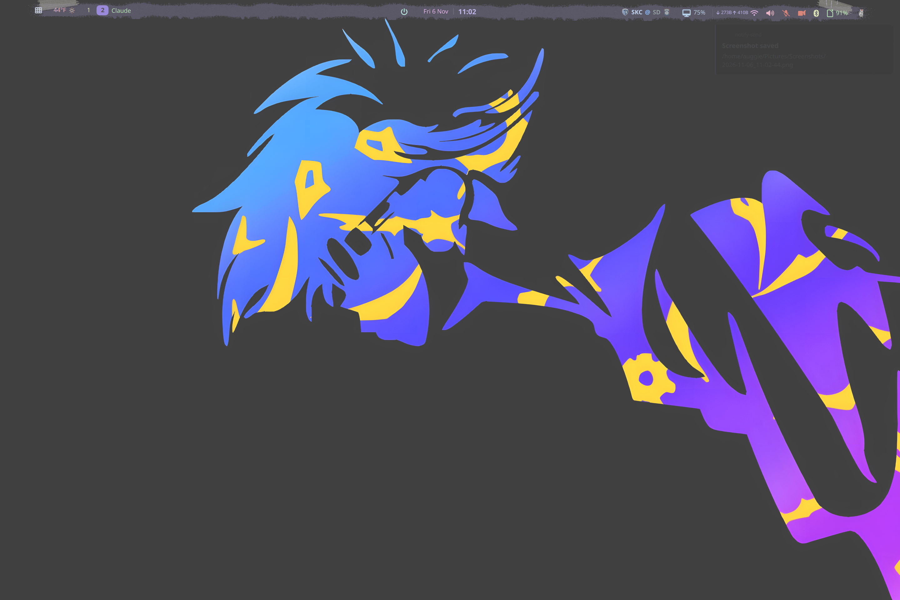
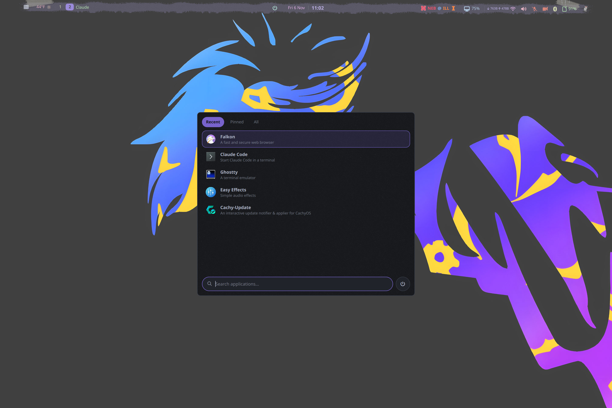

# auggbar

A Quickshell bar and desktop shell for Hyprland: bar, app launcher, notifications and clipboard history, with a wallpaper-driven theme.

A single Quickshell top bar for Hyprland, made of plugins that can each be
turned on/off, moved, and configured from the bar itself.

## What's new (2026-11-24)

**Scoreboard: smart polling and offline mode.** The scoreboard plugin used to re-read ESPN every minute (about 45 requests a minute for a typical setup). Now it only goes to the network when there is something to learn, and it remembers the rest:

- Game times are re-checked a few times a day (just after midnight, then 6 AM, noon and 5 PM; only midnight and noon when no favourite plays within 24 hours).
- A league is polled for live scores only while one of your favourite teams' games is on or about to start, and then with a single request for today.
- Leagues with no favourite team or driver are not fetched at all (unless "league in cycle" is on).
- Schedules, team lists and favourite-team logos are stored on disk, so the bar keeps showing the last known schedule and logos with no network, and the settings team picker opens instantly.
- The bar no longer even starts the fetcher until something is due.

See [Scoreboard plugin](#scoreboard-plugin) for details.

## Screenshots

The bar is wallpaper-coloured glass: it, and the text on every widget, recolour
whenever the background changes (every five minutes).






## Install

```sh
./install.sh            # copy into ~/.config/quickshell
./install.sh --link     # symlink instead: edit this folder and the bar follows
./uninstall.sh          # remove it and restore what it replaced (--purge also drops settings)
```

Other flags: `--yes` (no prompts), `--no-deps`, `--no-autostart`, `--no-restart`.

The installer checks for the required packages (and offers to `pacman -S` the
missing ones), places the bar and its helper scripts, writes default plugin
settings if you have none, and adds a Quickshell autostart to Hyprland if there
isn't one. Whatever it replaces goes to `~/.local/share/auggbar/backup/`.

## Using it

- **Right-click or Alt+click empty bar space**: the plugin menu. Every plugin
  has an on/off switch, ‹ › to move it, a section picker, and a gear for its
  settings.
- **Right-click or Alt+click a plugin**: that plugin's settings. Weather,
  scoreboard, launcher, Bluetooth and Viking open their own panels; the others
  open a popup with show/hide, position and their options.
- Audio: middle-click mutes (right-click is settings now).

Settings live in `~/.config/auggbar/settings.json`; the menus write it, and the
bar reloads it live if you edit it by hand.

From a terminal or keybind:

```sh
qs -p ~/.config/quickshell ipc call bar settings            # plugin menu
qs -p ~/.config/quickshell ipc call bar pluginSettings cava  # one plugin
qs -p ~/.config/quickshell ipc call bar togglePlugin title
qs -p ~/.config/quickshell ipc call bar movePlugin weather -1
```

## Plugins

| id | what | options |
|---|---|---|
| launcher | app launcher button (owns Super+Space) | own panel |
| weather | temperature + condition | own panel |
| workspaces | Hyprland workspaces | |
| title | focused window title | max width |
| cava | audio visualizer; shows while music plays, click to open it as a tiled app window | bars, hide when idle, window on/off |
| power | power menu | |
| clock | date/time, click for calendar | 24h, show date, calendar accounts |
| nowplaying | MPRIS controls + ticker | ticker width |
| scoreboard | live scores for your teams | own panel |
| display | monitors + brightness | show % |
| separator | divider | |
| system | the grouped card; holds everything in the `system` section | |
| netspeed, network, audio, mic, bluetooth, battery | system controls | audio: scroll step; battery: show %; bluetooth: own panel |
| viking | running-viking CPU monitor | own panel |
| updater | CachyOS updates (arch-update) | |
| tray | system tray | |

## Layout

```
shell/                 -> ~/.config/quickshell
  shell.qml            shared state, popups, bar frame, plugin loader
  Theme.qml            palette singleton (follows the Auggment theme)
  widgets/<Plugin>.qml one file per plugin
  widgets/PluginSlot.qml  loads a plugin + routes right/Alt-click to settings
  components/          launcher + viking components
  quickshell-scripts/  scoreboard (fetch-scores.py, smartcache.py, teams_lib.py, ...) + display backends
bin/                   -> ~/.local/bin (auggment-* helpers)
config/settings.json   default plugin layout
```

## Scoreboard plugin

Shows live and upcoming scores for your favourite teams (and NASCAR/F1/IndyCar drivers, PGA golfers) from ESPN, plus TheSportsDB for the CFL. Pick teams in the plugin's panel; settings are in `~/.config/auggment/scoreboard.json`.

**How it polls**

| situation | network use |
|---|---|
| favourite game more than 24 h away | 2 schedule checks a day (00:05, 12:05) |
| favourite game within 24 h | 4 schedule checks a day (00:05, 06:05, 12:05, 17:05) |
| favourite game starting in <5 min, or in progress | 1 request per poll for today's games |
| no favourite in a league | nothing (league is skipped) |
| offline | retries with growing delays (1 min up to 15 min); last known schedule keeps showing |

`refresh_seconds` (Settings > Scoreboard) is how often a *live* favourite game is polled; it does nothing while no favourite game is on. The Refresh button re-reads games happening around now.

**What is cached** (all under `~/.cache/auggment/`, safe to delete; it rebuilds itself):

- `scoreboard-events/` — raw schedule per league (this is what makes offline mode work)
- `scoreboard-logos/` — logos of your favourite games, shown from disk
- `scoreboard-misc.json` — team lists for the picker (7 days)
- `scoreboard-cache.json` — the ready-to-display document, stamped with `next_poll_at`

`smartcache.py` holds the polling rules and is shared with the [Auggmented Scoreboard](https://github.com/auggnation/Auggment-Scoreboard) kiosk app; keep the two copies identical.

### Writing a plugin

1. Create `shell/widgets/Foo.qml`. Its root needs `required property var shell`
   and `property bool shown` (false hides it), plus `implicitWidth/Height`.
   Colours come from `Theme` (`import ".."`).
2. Optional: `readonly property var settingsSchema: [{ key, label, type:
   "bool"|"number"|"action", default, min, max, step, suffix }]`, read values
   with `shell.barOpt("foo", key, default)`, handle actions in
   `function settingsAction(key)`. Or provide `function openSettings()` to
   open a panel of your own.
3. Register it in `barWidgetFiles` / `barLabels` / `barDefaults` in `shell.qml`.

## How This Was Made

I write this project myself and use [Claude Code](https://claude.com/claude-code), Anthropic's AI coding assistant, to help build it and to review and double-check my work. I mention it plainly because you should know how the software you run was made. Every change is mine to own, so if something is broken, open an issue or send a pull request.
